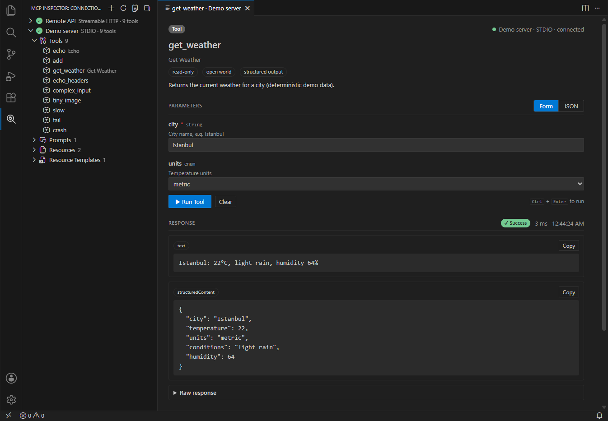
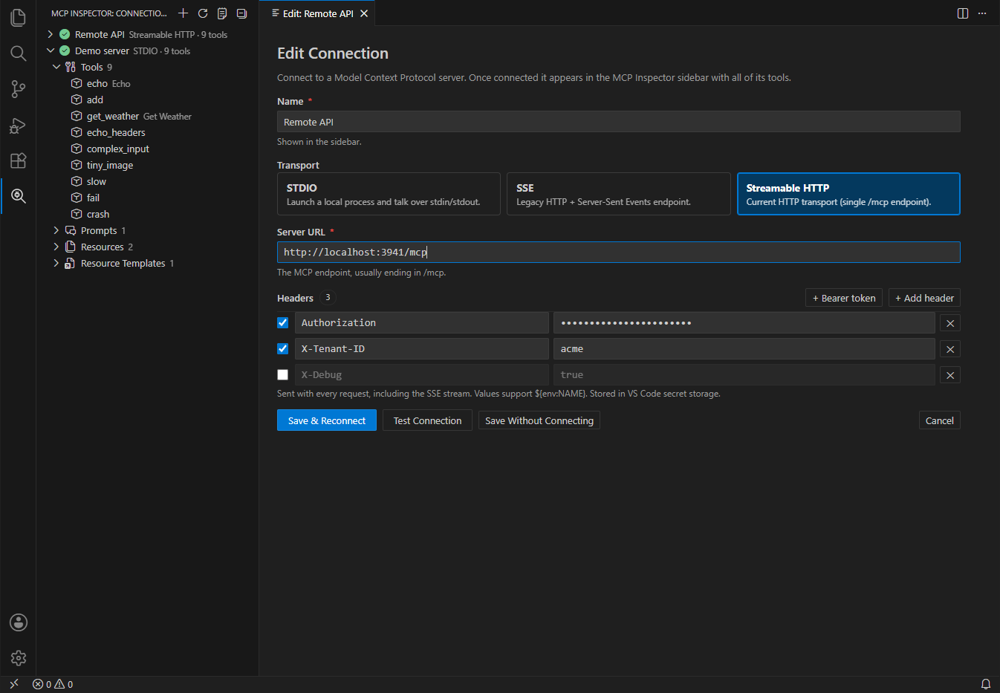

# MCP Inspector for VS Code

Inspect and debug [Model Context Protocol](https://modelcontextprotocol.io) servers without leaving the editor.



- **MCP Inspector** view in the activity bar with a **Create New Connection** button
- Connect over **STDIO**, **SSE** or **Streamable HTTP**
- Edit every **header** (Authorization, API keys, tenant headers, …) and **environment variable**, and enable or disable each one without deleting it
- A connection is only added after it connects successfully. It then appears in the sidebar under the name you gave it.
- Every **tool**, **prompt**, **resource** and **resource template** the server offers is listed under the connection
- Click an item to see its details (description, annotations, input/output schema) and **run it**, or use the ▶ button next to it to run it straight away with the last arguments:
  - a form generated from the JSON Schema, or raw JSON
  - progress notifications, cancellation, duration
  - text (JSON is formatted), images, audio, embedded resources, resource links and `structuredContent`
  - raw response with **Copy** / **Open in Editor**
- Lists refresh automatically when the server sends `list_changed` notifications
- Every JSON-RPC message, server log and stderr line is written to the **MCP Inspector** output channel
- Connection errors show the underlying cause (refused connections, malformed HTTP responses, the server's stderr) instead of a bare "fetch failed"



## Installation

Download the `.vsix` from the [latest release](https://github.com/co3moz/vsc-mcp-inspector/releases/latest) and install it:

```bash
code --install-extension vsc-mcp-inspector-<version>.vsix
```

Or use **Extensions** → **⋯** → **Install from VSIX…**.

## Usage

1. Open the **MCP Inspector** view in the activity bar.
2. Click **Create New Connection**.
3. Enter a name and choose a transport:
   - **STDIO** – command (`npx`, `node`, `uvx`, `docker`, …), arguments, working directory and environment variables. Pasting a full command line such as `npx -y @modelcontextprotocol/server-everything` into *Command* splits it into command and arguments.
   - **SSE** – the SSE endpoint URL (usually `…/sse`) plus headers.
   - **Streamable HTTP** – the MCP endpoint URL (usually `…/mcp`) plus headers.
4. Click **Test Connection** to check the server, or **Connect & Save** to add it.
5. Expand the connection and click a tool to open it. Fill in the parameters and press **Run Tool** (<kbd>Ctrl</kbd>+<kbd>Enter</kbd>).

Right-click a connection to connect, disconnect, reconnect, edit, delete it or show server info.

### Variables

Header values, environment values, arguments, the command, the working directory and the URL can use:

| Variable | Value |
| --- | --- |
| `${env:NAME}` | Environment variable of the VS Code process |
| `${workspaceFolder}` | First workspace folder |
| `${userHome}` | Home directory |
| `${pathSeparator}` | `\` on Windows, `/` elsewhere |

For example, set the header `Authorization` to `Bearer ${env:MY_API_TOKEN}` so the token never gets stored.

### Where connections are stored

Connection settings are kept in VS Code's global state. Header and environment variable **values are stored in VS Code's SecretStorage** (the OS keychain), not in settings files.

## Settings

| Setting | Default | Description |
| --- | --- | --- |
| `mcpInspector.requestTimeout` | `60` | Timeout in seconds for connecting and for each request. Progress notifications reset it. |
| `mcpInspector.logTraffic` | `true` | Log every JSON-RPC message to the output channel. |

## Development

```bash
npm install
npm run build          # bundle to dist/extension.js
npm run watch          # rebuild on change
npm run check          # type-check
```

Press <kbd>F5</kbd> to start an Extension Development Host.

`test/server.mjs` is a small MCP server for trying out the inspector. It has tools with many parameter types, structured output, images, progress, errors, prompts, resources and a resource template:

```bash
npm run test-server                         # Streamable HTTP on :3001/mcp, SSE on :3001/sse
REQUIRE_TOKEN=secret npm run test-server    # also require "Authorization: Bearer secret"
node test/server.mjs stdio                  # stdio
```

Tests:

```bash
npm run test:core          # McpSession against the test server over all three transports
npm run test:integration   # inside VS Code (set VSCODE_EXECUTABLE to use an installed VS Code)
```

Packaging: `npm run package` creates a `.vsix`. Change `publisher` in `package.json` to your Marketplace publisher ID before publishing.

### CI

[`.github/workflows/build.yml`](.github/workflows/build.yml) runs on every push and pull request: it type-checks, runs the core tests and packages the extension. The `.vsix` is attached to the workflow run as an artifact named `vsc-mcp-inspector-<version>-<commit>.vsix` (**Actions** → run → **Artifacts**).

To publish a release, bump `version` in `package.json`, commit, then push a matching tag:

```bash
git tag v0.2.0
```

```bash
git push origin v0.2.0
```

The workflow checks that the tag matches `package.json`, builds `vsc-mcp-inspector-<version>.vsix` and attaches it to a GitHub release with generated notes.
