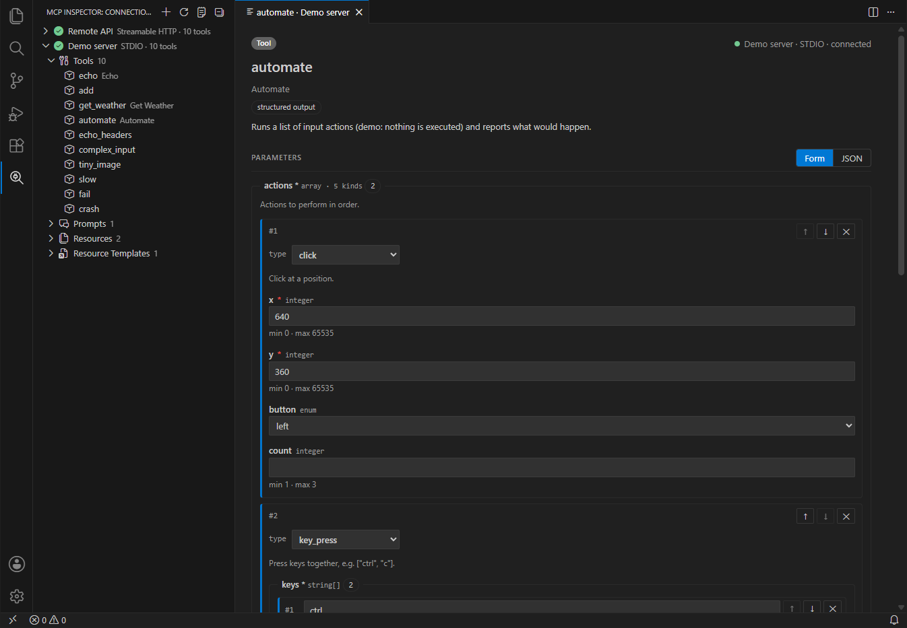

# MCP Server Inspector for VS Code

Inspect and debug [Model Context Protocol](https://modelcontextprotocol.io) servers without leaving the editor.


- **MCP Inspector** view in the activity bar with a **Create New Connection** button
- Connect over **STDIO**, **SSE** or **Streamable HTTP**
- Edit every **header** (Authorization, API keys, tenant headers, …) and **environment variable**, and enable or disable each one without deleting it
- A connection is only added after it connects successfully. It then appears in the sidebar under the name you gave it.
- Every **tool**, **prompt**, **resource** and **resource template** the server offers is listed under the connection
- Click an item to see its details (description, annotations, input/output schema) and **run it**, or use the ▶ button next to it to run it straight away with the last arguments:
  - a form generated from the JSON Schema: nested objects, **arrays** with add / remove / reorder, and **`oneOf` / `anyOf`** variants picked by their discriminator (e.g. `"type": "click"`)
  - or a **JSON editor** with syntax highlighting, completion of property names, values and whole variant templates from the schema (<kbd>Ctrl</kbd>+<kbd>Space</kbd>), hover documentation and schema validation
  - progress notifications, cancellation, duration
  - text, images, audio, embedded resources, resource links and `structuredContent`; JSON is shown in a read-only editor with folding
  - the raw result with **Copy** / **Open in Editor**
- Lists refresh automatically when the server sends `list_changed` notifications
- Every JSON-RPC message, server log and stderr line is written to the **MCP Inspector** output channel
- Connection errors show the underlying cause (refused connections, malformed HTTP responses, the server's stderr) instead of a bare "fetch failed"




## Installation

Search for **MCP Server Inspector** in the Extensions view (VS Code uses the [Visual Studio Marketplace](https://marketplace.visualstudio.com/items?itemName=co3moz.vsc-mcp-inspector); VSCodium, Cursor, Windsurf and other editors use [Open VSX](https://open-vsx.org/extension/co3moz/vsc-mcp-inspector)), or download the `.vsix` from the [latest release](https://github.com/co3moz/vsc-mcp-inspector/releases/latest) and install it:

```bash
code --install-extension vsc-mcp-inspector-<version>.vsix
```

Or use **Extensions** → **⋯** → **Install from VSIX…**.

## Usage

1. Open the **MCP Inspector** view in the activity bar.
2. Click **Create New Connection**.
3. Enter a name and choose a transport:
   - **STDIO** – command (`npx`, `node`, `uvx`, `docker`, …), arguments, working directory and environment variables. Pasting a full command line such as `npx -y @modelcontextprotocol/server-everything` into *Command* splits it into command and arguments.
   - **SSE** – the SSE endpoint URL (usually `…/sse`) plus headers.
   - **Streamable HTTP** – the MCP endpoint URL (usually `…/mcp`) plus headers.
4. Click **Test Connection** to check the server, or **Connect & Save** to add it.
5. Expand the connection and click a tool to open it. Fill in the parameters and press **Run Tool** (<kbd>Ctrl</kbd>+<kbd>Enter</kbd>).

Right-click a connection to connect, disconnect, reconnect, edit, delete it or show server info.

### Reading a tool result

A tool call returns a `CallToolResult` with these parts, shown separately:

- **content** – blocks meant for the model: `text`, `image`, `audio`, embedded `resource` and `resource_link`.
- **structuredContent** – a JSON object for programs, validated against the tool's `outputSchema`. The MCP spec asks tools that return it to also put the same JSON in a `text` block for older clients; when the two match, the text block is collapsed as "same JSON as structuredContent".
- **Raw result** – the whole `result` object of the JSON-RPC response exactly as received (including `isError` and `_meta`), useful for debugging the server. Long strings such as base64 images are shortened in the view; Copy and Open in Editor keep them intact.

### Variables

Header values, environment values, arguments, the command, the working directory and the URL can use:

| Variable | Value |
| --- | --- |
| `${env:NAME}` | Environment variable of the VS Code process |
| `${workspaceFolder}` | First workspace folder |
| `${userHome}` | Home directory |
| `${pathSeparator}` | `\` on Windows, `/` elsewhere |

For example, set the header `Authorization` to `Bearer ${env:MY_API_TOKEN}` so the token never gets stored.

### Where connections are stored

Connection settings are kept in VS Code's global state. Header and environment variable **values are stored in VS Code's SecretStorage** (the OS keychain), not in settings files.

## Settings

| Setting | Default | Description |
| --- | --- | --- |
| `mcpInspector.requestTimeout` | `60` | Timeout in seconds for connecting and for each request. Progress notifications reset it. |
| `mcpInspector.logTraffic` | `true` | Log every JSON-RPC message to the output channel. |

## Feedback

Found a bug or have an idea? Open an issue on [GitHub](https://github.com/co3moz/vsc-mcp-inspector/issues).
